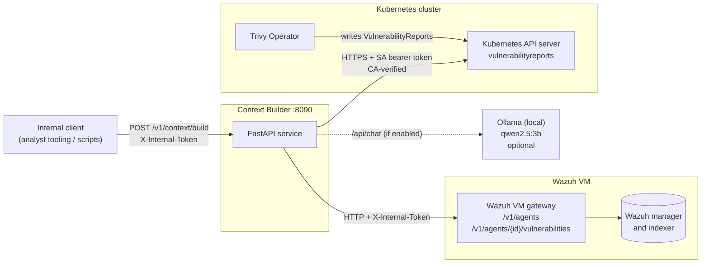
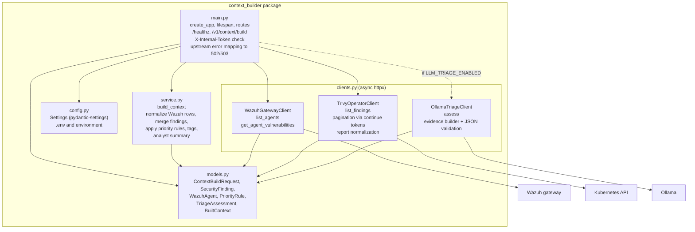
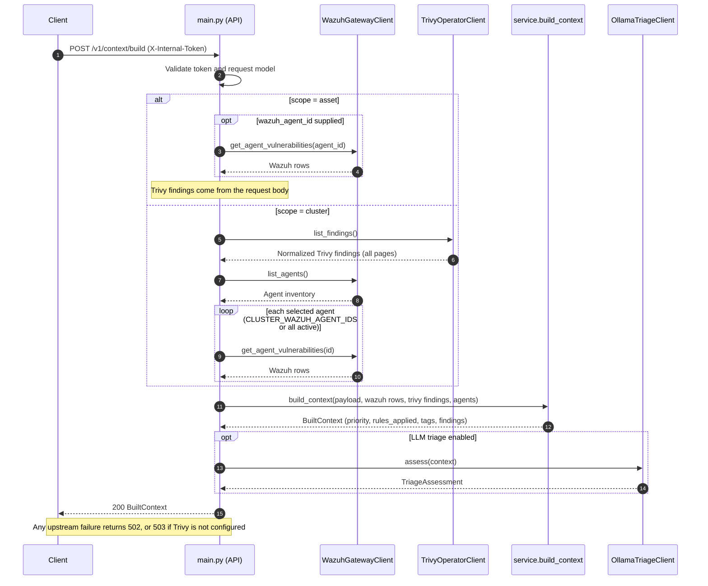
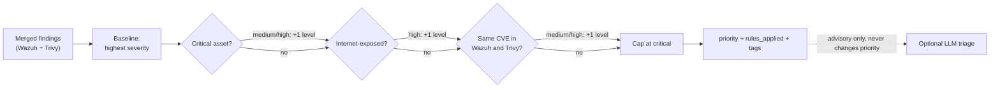

# Security Context Builder – Architecture

Diagrams use [Mermaid](https://mermaid.js.org), which GitHub renders natively.
For setup and API usage see [USAGE.md](USAGE.md).

## 1. System context

## 2. Application components

Notes:

- Each client gets its own lifespan-managed `httpx.AsyncClient` created in
  `main.py`, so Trivy TLS/CA settings and the long LLM timeout do not affect
  the Wazuh client. The Trivy client is only created when
  `TRIVY_REPORTS_URL` is set, and the LLM client only when
  `LLM_TRIAGE_ENABLED=true`.
- `service.py` is pure and synchronous: it takes already-fetched data and
  returns a `BuiltContext`, so it is unit-testable without network access.

## 3. Request flow

## 4. Priority pipeline

## 5. Security boundaries

| Boundary | Control |
|---|---|
| Client → Context Builder | `X-Internal-Token`, constant-time comparison |
| Context Builder → Wazuh gateway | `X-Internal-Token` (gateway token) |
| Context Builder → Kubernetes API | Read-only service account (`get`, `list` on `vulnerabilityreports`), bearer token sent only over HTTPS, TLS verified against `TRIVY_API_CA_FILE` |
| Context Builder → Ollama | Local endpoint; only aggregate counts, agent inventory and up to 8 top findings per source (titles truncated) are sent |
| Secrets | `.env` and `secrets/` are git-ignored; keep mode 600 |
| Actions | None. The service only reads and reports; LLM output is advisory |
